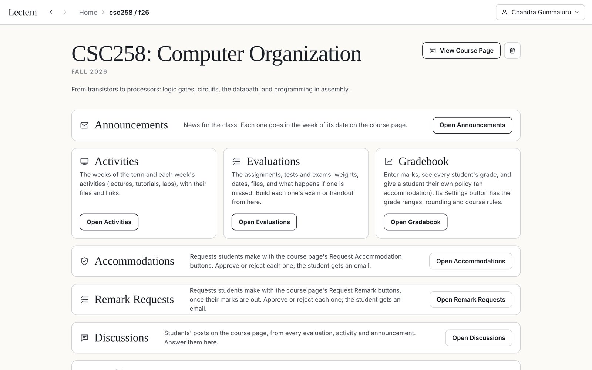
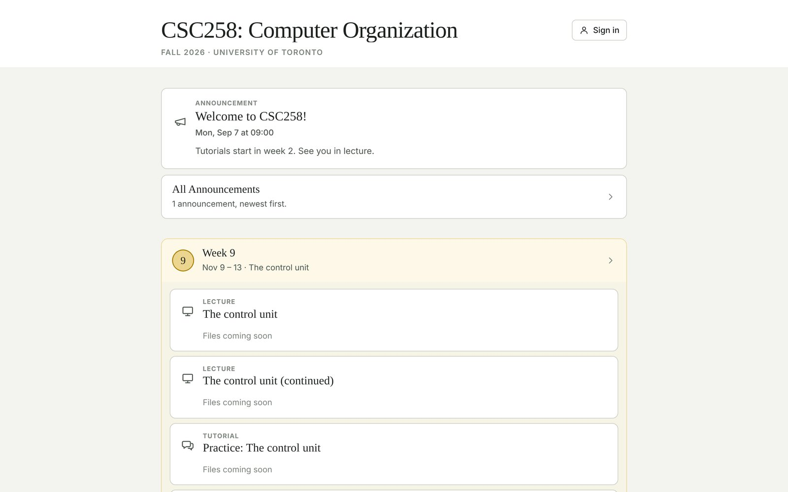
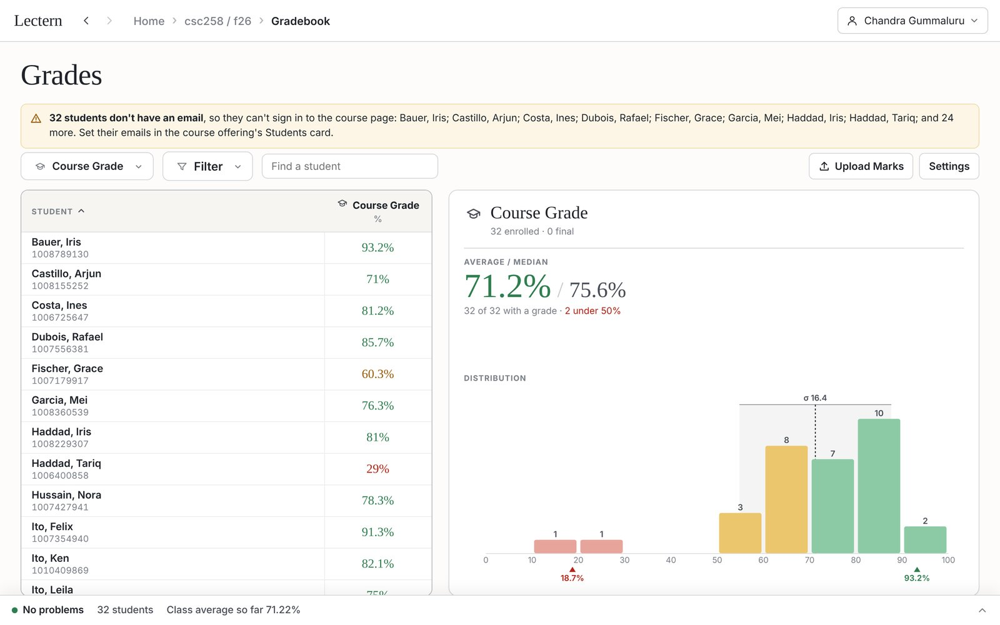
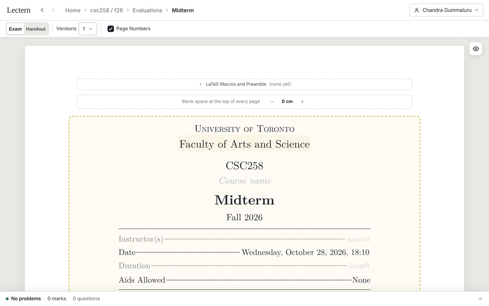
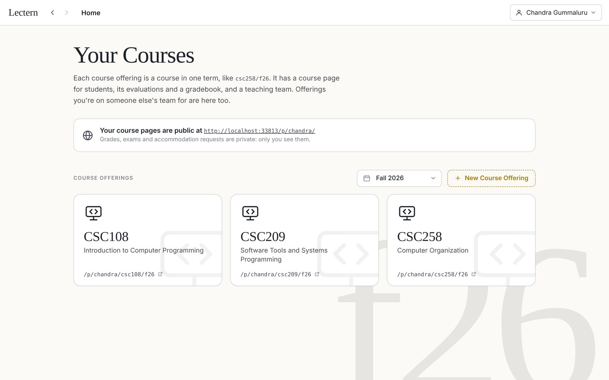

**[Open Lectern](https://lectern.changapp.net)** · **[View the source on GitHub](https://github.com/chandra-gummaluru/lectern)**

Running a course usually means keeping five things in sync by hand: a course website, a spreadsheet of marks, a folder of LaTeX exams, an inbox full of "I missed the midterm" emails, and a syllabus that has to agree with all of them. Change a due date and you have to update it in four places. Forget one and students notice.

Lectern puts all of it in one place. For each course offering (a course in one term, like CSC258 in Fall 2026) it keeps the **course page**, the **gradebook** and the **exams** together. Changing one updates the rest, so you set something once and it's correct everywhere.

## A course page that builds itself

You don't design the course page. You fill in your weekly activities, announcements, evaluations and teaching team, and Lectern turns them into a clean course website with tabs for *This week*, *Announcements*, *Activities*, *Evaluations* and *About*.

The page opens on **This week**, so students land on what matters right now: this week's lectures and tutorials, what's due, and the latest announcement. Each evaluation appears automatically in the week it's due, and the marking scheme on the page comes straight from your gradebook, so it's always correct.

You choose which tabs are public and which need a sign-in. The page also works on phones and can be embedded in Quercus.

## A gradebook that understands your syllabus

Set up evaluations with weights, due dates, "best 7 of 8", makeups and passing rules (e.g. "below 40% on the final caps your grade at 47%"). Import your class list from Quercus or ACORN, then enter marks or upload them. Lectern computes every student's course grade and shows how the class is doing, including the average, the median, the spread, and who is below 50%.

## Exams written where they're graded

Open any evaluation's test or assignment and write it in place, with multiple versions, an answer key and a marking guide. Its total marks feed straight back into the gradebook, so the exam and the marking scheme never disagree.

## Accommodations without the email chain

Students request an accommodation for a missed evaluation right from the course page, before a deadline you set. You see every request in one list, approve or reject it with a note, and Lectern emails the student the decision. Students only ever see their own requests.

## Built for a teaching team

Add instructors and TAs to any offering. Instructors can do everything you can. TAs can see the gradebook and enter marks, but can't change the course setup, and Lectern's server enforces that. Every save keeps the earlier version, so mistakes can be undone.

## Private by default, secure throughout

The course page is the only thing that's ever published. Grades, exams and accommodation requests are visible only to you and your teaching team. Students sign in with their email and a one-time code.

On the server side, Lectern is invite-only and uses argon2id password hashing and optional two-factor sign-in. Sessions are server-side, and published course pages are sandboxed so they can't touch anything private.

## Use it

**At the University of Toronto:** Lectern is running at [lectern.changapp.net](https://lectern.changapp.net). It's invite-only, so [email me](mailto:chandra@cs.toronto.edu) if you'd like an account for your course.

**Anywhere else:** Lectern is open source and small enough to run yourself. All it needs is Python 3 and an HTTPS address, and one script sets everything up:

1. `git clone https://github.com/chandra-gummaluru/lectern.git ~/apps/lectern`
2. `~/apps/lectern/new-lectern.sh`

The script asks for your address, your email settings and a first administrator, and then you're ready to invite instructors. Full instructions are in the [README](https://github.com/chandra-gummaluru/lectern).

Lectern can also be installed as an app, with its own window and icon, on your computer, iPhone or iPad.
